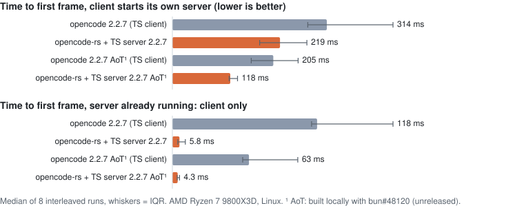
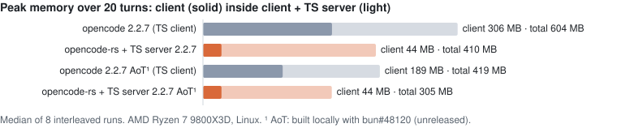

# OpenCode native CLI preview builds

Preview builds of `opencode-rs`, the Rust client for [OpenCode](https://github.com/anomalyco/opencode), built from
its `oc-rust` branch (`packages/cli-rs`). The [build workflow](.github/workflows/build.yml) runs nightly when
`oc-rust` has moved, and on demand; each build is a [prerelease](https://github.com/simonklee/cli-rs-preview/releases)
for Linux x64, Linux arm64 and macOS arm64 (Apple silicon). Windows follows with the Windows port.

These are unsigned previews for testers, not releases.

## Why


One real run, not sped up: `opencode` 2.2.7 from npm (top) and `opencode-rs` 0.0.0-rs-2 (bottom), started at the
same moment in identical sandboxes against a mock LLM provider. Each starts its own TypeScript 2.2.7 server. AMD Ryzen 7
9800X3D, Linux.

<picture>
  <source media="(prefers-color-scheme: dark)" srcset="docs/startup-dark.svg">
  
</picture>

<picture>
  <source media="(prefers-color-scheme: dark)" srcset="docs/memory-dark.svg">
  
</picture>

| median of 8 runs | `opencode` 2.2.7 | `opencode-rs` + TS server 2.2.7 |
|---|---|---|
| first frame, client starts its own server | 314 ms | 219 ms |
| first frame, server already running | 118 ms | 5.8 ms |
| client peak memory, 20 turns | 306 MB | 44 MB |
| client + server peak memory | 604 MB | 410 MB |
| client CPU, 20 turns | 4.15 s | 0.16 s |

First frame is the time from starting the client to the first character it prints in a 120×40 terminal; memory is
the peak RSS of the client process, and of the client with its server, sampled every 20 ms over 20 prompts. Each
label ran 8 times, interleaved with the others, with a throwaway `HOME` and an offline mock provider;
[docs/benchmark.md](docs/benchmark.md) has the method, all eight labels (including an experimental ahead-of-time
build of 2.2.7), the raw CSV, the versions and the machine.

`opencode-rs` replaces only the client. It still runs the TypeScript server, which now holds most of the remaining
memory (374 of 410 MB) and CPU, so whole-tree savings are smaller than the client's own.

## Install

```sh
curl -fsSL https://raw.githubusercontent.com/simonklee/cli-rs-preview/main/install.sh | bash
```

This installs the newest build to `~/.local/bin/opencode-rs` (set `OPENCODE_RS_INSTALL_DIR` to change it) after
checking it against the release's `SHA256SUMS`. Run it again to update; `opencode-rs upgrade` updates the TypeScript
CLI, not `opencode-rs`. Linux builds need glibc 2.35 or newer (Ubuntu 22.04+, Debian 12+, Fedora 36+); musl is not
supported yet.

Each release also carries a `manifest.json` naming the OpenCode commit, its `dev` base and the OpenTUI commit, and a
build attestation: `gh attestation verify opencode-rs-<version>-<target>.tar.gz --repo simonklee/cli-rs-preview`.

## Requirements

`opencode-rs` is a client: it starts and talks to the TypeScript `opencode` server. Keep the TypeScript CLI on
`PATH` (or set `OPENCODE_TS_BIN` to it), version 2.2.7 or newer, or `@opencode/cli@dev`:

```sh
npm i -g @opencode/cli
```

`opencode-rs` uses the same sessions, configuration and server as `opencode`. To keep its client state (tabs and
other TUI storage) apart, set `OPENCODE_TUI_CHANNEL=rs-preview`.

## macOS

The binary has only an ad-hoc signature. `curl` sets no quarantine flag, so the install script's copy runs. If you
download an archive with a browser, clear the flag first:

```sh
xattr -d com.apple.quarantine opencode-rs
```
