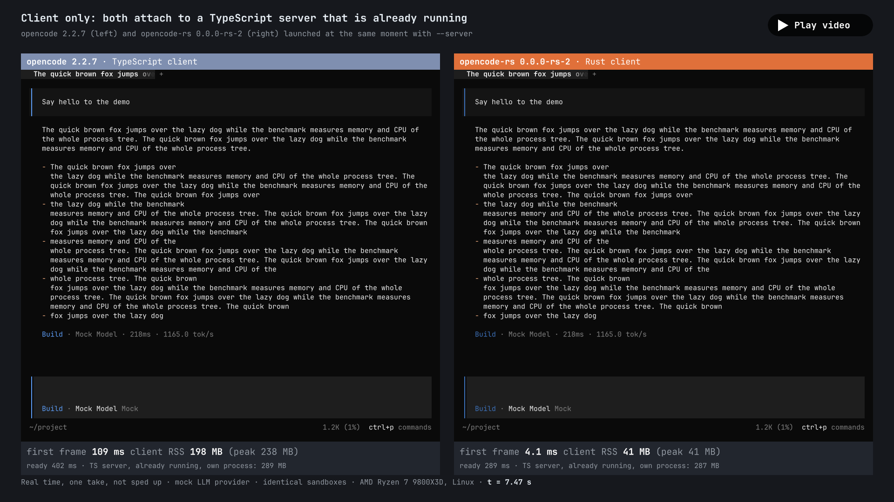
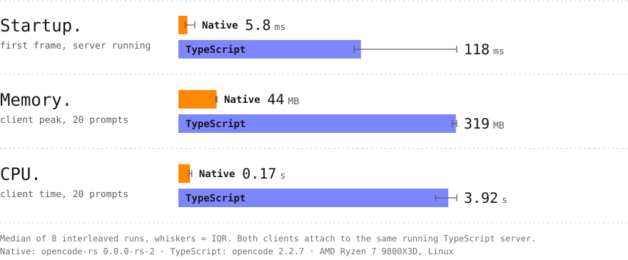
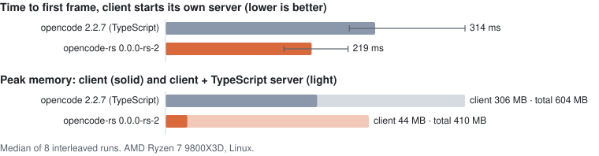

# opencode-rs preview builds

`opencode-rs` is a client for [OpenCode](https://github.com/anomalyco/opencode) written in Rust. This repository
builds it from the `oc-rust` branch (`packages/cli-rs`) and publishes each build as a
[prerelease](https://github.com/simonklee/cli-rs-preview/releases) for Linux x64, Linux arm64, and macOS arm64. These
are unsigned previews for testers, not releases.

[](docs/demo.mp4)

Both clients start at the same moment and attach to a TypeScript server that is already running. The Rust client
draws its first frame in 4.1 ms and holds 41 MB; the TypeScript client takes 109 ms and peaks at 238 MB. This is one
real run, not sped up (`opencode` 2.2.7 and `opencode-rs` 0.0.0-rs-2, AMD Ryzen 7 9800X3D, Linux). Click the image for
the [MP4](docs/demo.mp4).

## How it works

`opencode-rs` builds on OpenTUI's new Rust bindings. They drive the same native terminal UI library, OpenTUI's Zig
core, that the TypeScript CLI uses through `@opentui/core`. So the port is close to 1:1: the same screens, keys,
and themes. A parity harness runs both clients on the same input and compares what they draw and what they send to
the server.

`opencode-rs` is only the client. It talks to the same TypeScript `opencode` server over HTTP:

- With no flags, it finds the running background service, as `opencode` does, or starts one.
- `--server <url>` attaches to a server you name.
- `--standalone` starts a private server for this one client.

Sessions live in the server, so `opencode` and `opencode-rs` see the same sessions. `opencode-rs` also reads the same
`cli.json` (keybinds, theme, and session settings).

### Plugins

Plugins are the biggest difference.

- **Server plugins** (tools, providers, and other server-side plugins) run in the TypeScript server. They work the
  same for both clients.
- **TypeScript TUI plugins do not run in `opencode-rs`.** This covers the `plugins` entries in `cli.json`, the
  `plugins` directories, and the server's TUI plugins. `/plugins` lists each one as skipped with "TypeScript TUI
  plugins do not run in opencode-rs yet", and the client logs it once at startup.
- **Native TUI plugins load instead.** A native plugin is a shared library (`.so` on Linux, `.dylib` on macOS) built
  against the stable C ABI of `opencode-plugin-abi`. `opencode-rs` looks for plugins in the same places as the
  TypeScript client and reloads them when they change. There is no sandbox: a plugin is code you chose to run.
  Native plugins do not load on Windows yet.

The built-in plugins, including LaTeX and Mermaid, use the same plugin API, compiled in. Three TypeScript TUI plugins
are ported as examples: `opencode-subagents-sidebar`, `@mynameistito/opencode-force-input`, and
`opencode-session-usage`. To write one, start with the
[quick start](https://github.com/anomalyco/opencode/blob/oc-rust/packages/cli-rs/crates/plugin-abi/README.md); the
[plugin reference](https://github.com/anomalyco/opencode/blob/oc-rust/packages/cli-rs/docs/P.4.md) has the rest.

### Other differences you may notice

- `opencode-rs upgrade` in a preview build does not update anything. It tells you to re-run the install script.
- `/restart` is not offered, because the client never stops the shared background service. Run
  `opencode-rs service restart` instead.
- HTTPS uses the system's root certificates. `NODE_EXTRA_CA_CERTS` has no effect; add the CA to the system store or
  set `SSL_CERT_FILE`.
- The preview builds highlight 14 languages: JavaScript, TypeScript, TSX, Markdown, Zig, Rust, Python, Go, bash, HTML,
  JSON, YAML, CSS, and diff. Code in other languages shows in the text color.
- With `OTEL_EXPORTER_OTLP_ENDPOINT` set, the client exports logs but no traces.
- Some defects of the TypeScript client are fixed on purpose. For example, `opencode-rs run` and the exit message
  strip escape sequences from model output and session titles before they reach the terminal.
- There are no Windows builds yet.

The full list, with the reason for each, is in
[`parity/deviations`](https://github.com/anomalyco/opencode/tree/oc-rust/packages/cli-rs/parity/deviations).

## Startup and memory

The client alone, against a server that is already running:

| median of 8 runs | `opencode` 2.2.7 | `opencode-rs` 0.0.0-rs-2 |
|---|---|---|
| time to first frame | 118 ms | 5.8 ms |
| client peak memory, 20 prompts | 319 MB | 44 MB |
| client CPU time, 20 prompts | 3.92 s | 0.17 s |

<picture>
  <source media="(prefers-color-scheme: dark)" srcset="docs/client-dark.svg">
  
</picture>

The client starts its own server (`--standalone`):

| median of 8 runs | `opencode` 2.2.7 | `opencode-rs` 0.0.0-rs-2 |
|---|---|---|
| time to first frame | 314 ms | 219 ms |
| client peak memory, 20 prompts | 306 MB | 44 MB |
| client + server peak memory | 604 MB | 410 MB |
| client + server CPU time, 20 prompts | 6.93 s | 2.79 s |

<picture>
  <source media="(prefers-color-scheme: dark)" srcset="docs/standalone-dark.svg">
  
</picture>

Here the first frame mostly waits for the server to start. The TypeScript server also holds most of the memory: 374
of the 410 MB in the `opencode-rs` row. `opencode-rs` replaces only the client, so the whole-tree savings are smaller
than the client's own.

*Time to first frame* is the time from starting the client to its first output that prints a screen cell, in a
120×40 terminal. Memory is the peak RSS, sampled every 20 ms over 20 prompts. Each row ran 8 times, interleaved with
the others, with a throwaway `HOME` and an offline mock LLM provider. [docs/benchmark.md](docs/benchmark.md) has the
method, every measured configuration, the raw CSV, the versions, and the machine.

## Install

```sh
curl -fsSL https://raw.githubusercontent.com/simonklee/cli-rs-preview/main/install.sh | bash
```

The script checks the newest build against the release's `SHA256SUMS` and installs it to `~/.local/bin/opencode-rs`
(set `OPENCODE_RS_INSTALL_DIR` to change it). Run it again to update.

```console
$ opencode-rs --version
opencode-rs v0.0.0-rs-2
```

Linux builds need glibc 2.35 or newer (Ubuntu 22.04+, Debian 12+, Fedora 36+). musl is not supported yet.

Each release also has a `manifest.json` that names the OpenCode commit, its `dev` base, and the OpenTUI commit. To
verify a build's attestation:

```sh
gh attestation verify opencode-rs-<version>-<target>.tar.gz --repo simonklee/cli-rs-preview
```

## Requirements

`opencode-rs` needs the TypeScript CLI, version 2.2.7 or newer (or `@opencode/cli@dev`), on `PATH`, or
`OPENCODE_TS_BIN` set to it:

```sh
npm i -g @opencode/cli
```

To keep the client's own state (tabs and other TUI storage) apart from the TypeScript client's, set
`OPENCODE_TUI_CHANNEL=rs-preview`.

## macOS

The binary has only an ad-hoc signature. `curl` sets no quarantine flag, so the install script's copy runs. If you
download an archive with a browser, clear the flag first:

```sh
xattr -d com.apple.quarantine opencode-rs
```

## Reporting bugs

Include the output of `opencode-rs --version` and the end of `~/.local/share/opencode/log/opencode.log`
(`opencode-rs debug paths` prints the log directory). Each start logs a `cli starting` line with the version and the
commit the build came from.
